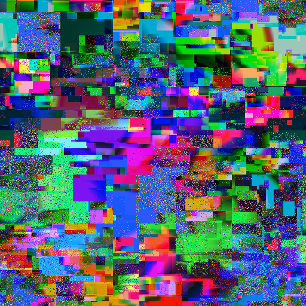
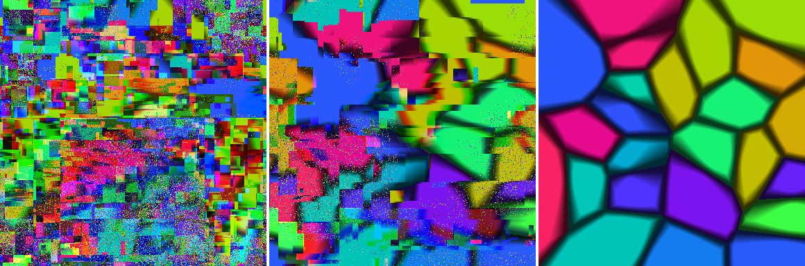
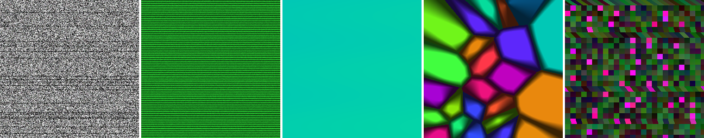

# DECAY

**Encrypt your message into the rot.**



The image above contains an encrypted letter. Not hidden *behind* the glitch —
the glitch **is** the letter: every tear, swap, and burst of static is driven
deterministically by the ciphertext of the message inside. Decay turns
encrypted correspondence into glitch art you can post, send, and print.

Whoever holds the image and the passphrase can open it. Nobody else can —
including us: there are no accounts, no servers, and nothing ever leaves your
device.

## The reveal



When the receiver enters the passphrase, the image **un-rots**. Every decay
operation is an invertible pixel transformation, so the app replays them
backwards — the corruption drains out of the image, the sender's original
carrier resurfaces, and the message reveals in step. No original file, no
stored animation: the received PNG and the passphrase are mathematically
sufficient to run the whole reveal.

## The fragility is the point

A Decay image survives **only as the original file**. Send the PNG itself —
as an attachment, a file share, a download link. A screenshot, a repost
through a platform that re-compresses images, or any resize destroys the
message forever. Decay letters are delicate objects, and that delicacy is
deliberate: it makes receiving one intact mean something.

## Decay styles

**Glitch** (default) scrambles the carrier with ciphertext-driven tears and
static. **Rot** keeps the image recognizable and stains it instead: every
character drops a spore of sickly green, brown or bruise purple, colored by
the character's value. Rot recovery is approximate (within a couple of levels
per channel); the message itself is always exact. See the
[Rot spec](docs/render-pipeline-v2-rot.md).

## Carriers



Messages are encrypted into a **carrier** — procedural art in three canonical
stages of decay, or (Pro) any image of your own:

| Stage | Aesthetic | Presets |
|---|---|---|
| **Erosion** | static & noise | TV Static *(Free)*, Scanlines |
| **Corruption** | geometric & generative | Gradient Melt, Voronoi Shatter |
| **Necrosis** | datamosh & glitch | Necrotic Blocks |

## Free and Pro

| | Free | Pro |
|---|---|---|
| Encrypt & send | ✔ | ✔ |
| **Decrypt anything** | **✔ always** | **✔ always** |
| Carrier presets | TV Static | All five |
| Custom carrier images | — | ✔ |
| Decay intensity dial (1–255) | locked at 100 | ✔ |
| Watermark on exports | small mark | none |

**Decryption is free, forever, for everyone.** A Decay image must never be
held hostage — anyone can open one with the passphrase, no purchase, no
account. That promise outranks every feature in this table.

Pro licenses are offline signed keys — verified on your device, no
activation server, no expiry.

## The promises

1. **Every image decodes forever.** The payload format is frozen and
   versioned; future decoders read every past version
   ([format spec](docs/payload-format-v1.md),
   [pipeline spec](docs/render-pipeline-v1.md)).
2. **Image + passphrase is everything.** No accounts, no servers, no
   original-file dependence, no version handshakes.
3. **Decryption never costs anything.**

## Under the hood

- AES-256-GCM with PBKDF2-HMAC-SHA256 (600k iterations), the whole
  authenticated container embedded in the pixels' low bits
- 120 invertible decay operations per image, derived from SHA-256 of the
  sealed container through a frozen deterministic PRNG — cross-platform,
  bit-exact, forever
- A built-in PNG codec; the engine has **zero external dependencies** and
  compiles to ~54 KB. It would fit on a floppy disk 26 times.
- .NET 10 / .NET MAUI: one codebase for Windows, iOS, Android, and macOS

## Building

```bash
dotnet test Decay.Core.Tests        # frozen format + crypto + PNG codec
dotnet test Decay.Renderer.Tests    # decay pipeline, presets, watermark, tiers
dotnet test Decay.Licensing.Tests   # offline license keys

dotnet workload install maui        # once
dotnet build Decay.App -f net10.0-windows10.0.19041.0   # or -ios / -android / -maccatalyst
```

See [docs/release.md](docs/release.md) for packaging, licensing operations,
and store notes.

---

A [Toothbrush Studio](https://toothbrush.studio) experiment in making
encryption feel like correspondence.
